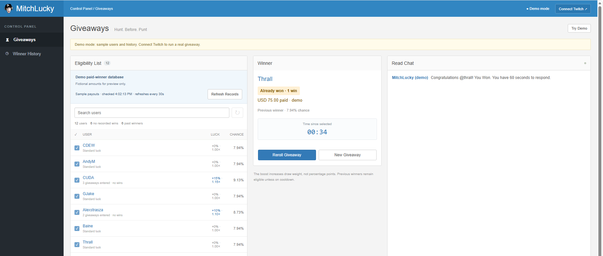
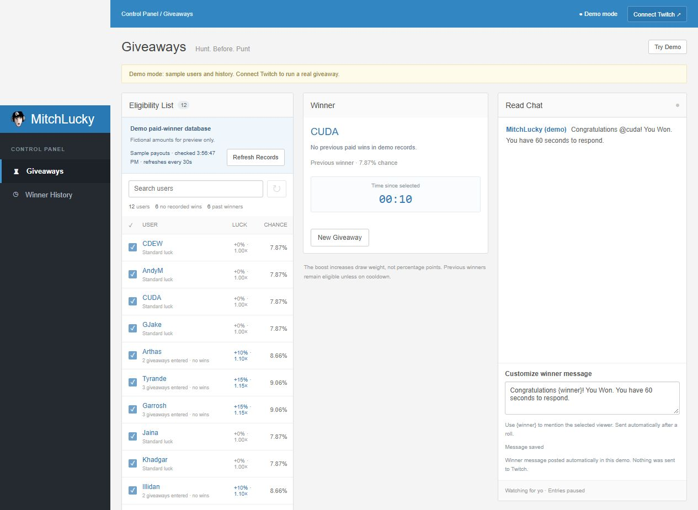

# MitchLucky

**[▶ Try the Public Demo](https://halunen.github.io/MitchLucky/)** — no install, Twitch account, or token required.

**Hunt. Before. Punt**

A local Twitch giveaway dashboard inspired by Nightbot, with a gradual, capped luck boost for viewers who have never won. Built for communities where repeat winners are common and giveaways can attract thousands of entrants.

The dashboard uses custom MitchLucky branding and your logo, with focused **Giveaways** and **Winner History** screens. The Twitch-connected bot runs locally. The public sample-data demo runs entirely in each visitor's browser; the external paid-winners database connection is the next integration.

## Example: select a winner and instantly see their previous wins

As soon as the bot selects a viewer, the winner card immediately shows whether they have a previous paid-win record in the available demo data. Individual payout details appear only after selection.

In the screenshot below, **Thrall** is selected and the card instantly shows **Already won · 1 win** and **USD 75.00 paid**. The bot also posts the automatic announcement, starts the response timer, and offers **Reroll Giveaway** or **New Giveaway**.



If the selected viewer has no matching paid-win record, the card instead shows **No previous paid wins in demo records.** This describes the available records; it does not claim the viewer has never won anywhere.

**This screenshot uses fictional demo payouts. The live paid-winners endpoint is not connected yet.**

## Features

| Feature | What it does |
| --- | --- |
| Instant selected-winner check | Immediately show the selected viewer's previous paid-win status, win count, and total paid from the available demo records. |
| Keyword giveaways | Viewers enter with `yo`, `YO`, or `Yo`. The keyword is configurable. |
| One entry per viewer | Repeated messages add neither entries nor luck. Twitch user IDs prevent duplicate entries under renamed accounts when available. |
| Gradual first-win luck | Never-winners earn +5% draw weight per giveaway they enter, capped at +25% by default. |
| Live luck slider | Adjust the maximum bonus from 0% to 50% while entries are open or paused. Chances preview while dragging; the cap saves on release. |
| Reroll without resetting | Select another winner from the same entry pool, skipping viewers already selected in that giveaway. |
| Direct winner selection | Click **Roll It!** while entries are open. One action stops entries and selects a winner using the displayed cap. |
| Eligibility controls | Everyone, Subscribers + Mods, Moderators, or Broadcaster. Exclude individual viewers or reset eligibility. |
| Active User mode | Collect viewers who chat during a configurable 1–60 minute activity window. |
| Winner timer | Count up from selection. Chat activity does not reset it. |
| Automatic winner announcements | Read incoming chat and automatically announce the selected winner using a customizable message. |
| Viewer explanations | Participation counts, individual bonuses, actual chances, and automatic `!luck` replies. |
| Winner history | Save selected winners per channel, review recent results, and export history as JSON. |
| [Exclude previous winners](#exclude-previous-winners) | Automatically exclude recent local winners with a timed cooldown, or manually exclude individual viewers before rolling. |
| Paid-winner preview | **Demo only:** show “Already won” badges, win counts, and sample payout totals on the selected winner card, plus refresh status. |

## Exclude previous winners

**You can exclude previous winners from a giveaway.** They remain eligible at standard luck by default; increasing first-win luck alone does not exclude them.

### Automatically exclude recent winners

1. Start a **New Giveaway** so its rules are editable.
2. Expand **Optional winner cooldown** in the Giveaway panel.
3. Choose how long a recent winner must wait, such as **24 hours**. Available periods range from **15 minutes to 30 days**; **Disabled** is the default.
4. Save or open entries. Viewers with a local, non-rerolled win inside that period are marked **Cooldown**, receive **0% chance**, and cannot be selected until the cooldown expires.

For example, a 24-hour cooldown excludes anyone selected as a winner by MitchLucky during the last 24 hours. Selecting a time window does not permanently ban every past winner.

### Manually exclude a viewer

While entries are open or paused, find the viewer using **Search users** and click the blue eligibility checkbox beside their name. They are marked **Excluded**, receive **0% chance**, and are skipped by the draw and subsequent rerolls. You can include them again before drawing. A new giveaway starts a fresh entry pool.

Rerolling also automatically skips everyone already selected in that same giveaway, without requiring manual exclusion.

The timed cooldown currently uses MitchLucky's local selection history. Fictional paid-winner demo records have no payout dates, so they do not trigger the timed cooldown. Their badges alone do not exclude them; manual exclusion still works. The live payout-database connection is pending.

## Winner workflow: roll, reroll, or start fresh

| Action | Entry pool | Luck progress | What happens next |
| --- | --- | --- | --- |
| **Roll It!** | Uses the current pool and stops new entries. No separate close step required. | Uses the displayed luck cap. | Selects a winner, shows their available paid-win status, starts the timer, and queues the automatic announcement. |
| **Reroll Giveaway** | Keeps the same pool and skips every viewer already selected in this giveaway. Entries stay closed. | Does not add participation or increase anyone's bonus. | Replaces the selected winner, restarts their timer, checks their available paid-win status, and announces them automatically. |
| **New Giveaway** | Clears the pool so viewers can enter again. Keeps the giveaway rules and saved message. | A viewer earns their next increase only when they enter the new giveaway. | Returns to the giveaway controls. Open entries when ready. |

After selection, **Reroll Giveaway** and **New Giveaway** are the two controls on the winner card. Earlier selections are marked **Rerolled** in history and excluded from later rolls in that same giveaway. They do not count as local wins or trigger local winner cooldowns. Paid-winner database records are never changed by a reroll.

Reroll uses the original keyword, manual exclusions, luck cap, and activity cutoff. It chooses a different eligible viewer; if nobody else remains eligible, the existing winner is preserved. Stale reroll requests are rejected so a double-click or another open dashboard cannot silently replace a newer selection.



**The 60-second response window is message text, not an automatic timeout.** The timer counts upward from selection and does not reset when someone speaks. It continues across page reloads and server restarts. You decide when to reroll; the bot does not reroll automatically at 60 seconds.

## Start locally

Requires **Node.js 22 or newer**.

```powershell
npm.cmd install
npm.cmd start
```

Open **http://127.0.0.1:38741/**. On Windows, you can also use `Start-MitchLucky.cmd`.

The server listens on `127.0.0.1`, so it is accessible from this computer. Keep it running while collecting entries.

## Try the demo

Open the **[public demo URL](https://halunen.github.io/MitchLucky/)** to show someone the app without installing anything. Each browser has its own sandbox: visitors do not affect each other's rolls or your live giveaways. The public demo has no Twitch login or token fields and makes no Twitch or payout-database requests.

Luck, winner selection, and rerolls use the same engine as the local app. Public demo history, participation, and custom messages are saved in that browser's local storage. New Giveaway followed by Open Entries automatically adds sample viewers for another round. Closing/reopening an existing pool adds no extra participation. Announcements appear only in the demo chat feed. Clearing the site's browser data resets its saved sandbox.

To try the Node app locally instead:

Click **Try Demo**. No Twitch account or token is needed.

You can test rolling, rerolling, automatic announcements, the luck cap, and both selected-winner outcomes without connecting Twitch. Switching to the demo replaces the current entry pool after confirmation while keeping real channel history separate.

The demo starts with **CDEW, AndyM, CUDA, and GJake**, followed by eight randomly selected World of Warcraft characters. Demo messages stay local and are never sent to Twitch. Demo participation and draw history are separate from real channel history.

Sample paid-winner records include:

| Demo username | Paid wins | Fictional total paid |
| --- | ---: | ---: |
| CDEW | 3 | USD 450.00 |
| AndyM | 1 | USD 100.00 |
| GJake | 2 | USD 250.00 |
| Thrall | 1 | USD 75.00 |
| Jaina | 2 | USD 200.00 |

**These are fictional examples, not statements about these people's actual winnings.** Paid-win badges, counts, and totals appear **only on the selected winner card after a roll**. The entrant list does not show individual payout details. If the selected viewer has no sample payout record, the winner card says so. CUDA has no sample payout record, making the difference easy to test.

The server rereads its in-memory demo provider every **30 seconds**. **Refresh Records** checks it immediately, and the panel shows the last check time. The demo response is also available at:

```text
GET /api/demo/paid-winners
```

This endpoint is available only while the demo sandbox is selected. It exposes the same fixed sample records that the demo provider reads; no external database requests occur. A shortened example response:

```json
{
  "demo": true,
  "winners": [
    { "username": "CDEW", "wins": 3, "totalPaid": 450, "currency": "USD" }
  ]
}
```

The paid-winner demo is read-only. Drawing someone does **not** create a payout or increase their paid total. Sample paid winners receive standard draw weight and no first-win bonus. Their payout counts are not added to overlapping local selection counts, and no payout dates are invented for the timed cooldown.

## How luck works

For viewers with no known wins:

| Giveaways entered | Bonus at the default cap | Draw weight |
| --- | ---: | ---: |
| 1 | +5% | 1.05× |
| 2 | +10% | 1.10× |
| 3 | +15% | 1.15× |
| 4 | +20% | 1.20× |
| 5 or more | +25% | 1.25× |

Each **distinct giveaway entered** counts once. Starting a new giveaway clears the pool; a viewer must enter again to earn another increase. Repeating the keyword, pausing/reopening entries, moving the slider, and giveaways a viewer does not enter add nothing. Bonuses add rather than compound. Prior winners get standard **1.00×** weight.

The keyword matches the complete chat message, ignoring surrounding whitespace and capitalization: `yo`, `YO`, and ` Yo ` work; `yoyo` and `yo chat` do not. **Reset Eligibility** excludes the existing pool; it does not delete participation history or award another increase. You can include individual viewers again before drawing.

The slider controls the **maximum extra weight**, not anyone's probability of winning. Actual odds are:

```text
viewer draw weight / total eligible draw weight
```

For example, with 2,000 eligible entrants and the default +25% cap, even the most favored entrant has at most approximately **0.0625%** chance. With 8,000 entrants, that bound is approximately **0.0156%**. If everyone has the same weight, everyone has equal odds. There is no guaranteed winner bonus.

Draws use Node's cryptographically secure random generator. Participation progress survives restarts. Previous local winners remain eligible unless excluded or on cooldown, but lose the first-win bonus in future giveaways. Old participation is not guessed; a pre-existing saved entry pool counts once when upgraded.

## Connect Twitch

1. Click **Connect Twitch** and enter your channel's Twitch login.
2. Choose **Read Chat Only** or **Read + Write Chat**.
3. For authenticated access, provide a Twitch user OAuth token with `chat:read`. Writing also requires `chat:edit` and explicitly selecting Read + Write Chat.
4. Save giveaway rules, open entries, and let viewers enter. Click **Roll It!** when ready; closing first is optional.
5. Use **Reroll Giveaway** to pick someone else from the same pool, or **New Giveaway** to collect fresh entries. Other entry rules stay locked once entries open; the luck cap remains adjustable.

Tokens are validated with Twitch, kept in server memory, and never saved. Anonymous read-only IRC is supported but may be restricted by Twitch. Authenticated live Twitch behavior still needs verification with your user token.

**Customize winner message** sets the announcement sent automatically after selection. The default is `Congratulations {winner}! You Won. You have 60 seconds to respond.`; `{winner}` becomes the selected viewer's Twitch @mention. The box saves automatically per channel, and Roll It! captures the text currently displayed, including recent edits. There are no manual Write Chat, Send, Winner Message, or Luck Rules controls.

Customize the message before selection. Once a winner is shown, the message box is locked; **New Giveaway** makes it editable again. A reroll uses the saved template and mentions the new selected viewer. If an earlier winner's announcement is still queued when you reroll, that unsent announcement is canceled.

Messages must be a single line of 1–425 characters; the final message must fit within 450 characters after replacing placeholders. Automatic sending requires an authenticated **Read + Write Chat** connection. Demo announcements appear only in the local Read Chat feed. The status below the message box shows queued, sent, demo, or not-sent results; the winner stays selected if chat writing is unavailable.

Announcements respect the chat send rate limit and are sent once per selection. Reloading or restarting does not replay them. An interrupted send is marked unconfirmed/not sent instead of being retried automatically, to avoid duplicate announcements. A successful send status means the message was handed to the Twitch connection, not that Twitch acknowledged delivery. Old selections made before automatic announcements were added are not announced retroactively.

With writing enabled, viewers can type `!luck` to check their participation, weight bonus, and current odds without entering the giveaway. Replies share the chat send rate limit; winner announcements take priority and rapid luck requests may not all receive replies. `!luck` is reserved for this command.

The winner timer and reroll behavior are described in [Winner workflow](#winner-workflow-roll-reroll-or-start-fresh).

## Real paid-winners database: next integration

**The live payout endpoint is not connected yet.** Real channels currently use MitchLucky's saved selection history for first-win eligibility, so they cannot identify older Nightbot winners from an external database.

The intended integration will periodically read your existing paid-winners endpoint and use it for paid-winner badges, win counts, and payout totals. Your payout system will remain the source of truth; MitchLucky will not manage payments or maintain a separate payout ledger.

Connecting it requires the endpoint URL, response format, authentication method, and the Twitch username/user ID fields it supplies. The sample JSON above is a demo format, not a required format for your existing API. Real response validation, username/ID matching, refresh failures, and stale-data behavior still need to be implemented against that endpoint.

Local draw history records **selection**, not payment or prize claims. It is separate from paid-winner records.

## Data and configuration

- `data/state.json` stores participation and selected-winner history per channel. Back up the `data` folder.
- Custom announcement templates and announcement status are saved too. Refreshing a page never resends an announcement.
- Fictional payout totals are read from the demo provider and are not persisted as payout history.
- `PORT` changes the listening port; default: `38741`.
- `DATA_DIR` selects another data directory. Run only one process per directory.
- Entries save in batches of up to 250 ms. Explicit actions save immediately using a temporary file and rename.
- Restarting pauses an open giveaway and preserves entrants. Reconnect and reopen, or draw from the saved pool. Messages missed while disconnected cannot be recovered.
- The table displays up to 500 matching entrants; **all eligible entrants participate in the draw**. History shows the latest 100 results while retaining older records on disk.
- A corrupt saved file stops startup rather than silently discarding history.
- Local state, tokens, dependencies, and environment files are excluded from Git.
- This is a focused giveaway tool. General Nightbot commands, moderation automation, and scheduled messages are not included.

## Development and verification

```powershell
npm.cmd test
```

The current suite has **24 automated tests**, covering weighted draws, duplicate entries, participation growth and caps, account renames, time cooldowns, an 8,000-entrant odds calculation, saved history across restarts, demo paid-winner isolation, automatic announcement templates, rate limiting, and avoiding duplicate sends across restarts. Reroll tests also cover preserving the pool and participation, excluding earlier selections by username/user ID, retaining the activity cutoff, rejecting stale requests, and leaving the winner intact when the pool is exhausted. Public demo tests check isolated visitor storage, the draw/reroll/announcement flow, persistence after reload, and an artifact without credential fields or live network access. The 8,000-entrant test checks odds calculations; it is not a live Twitch load benchmark.

### Rebuild the public demo

```powershell
npm.cmd run build:demo
```

The build copies the UI, shared giveaway engine, branding, and fictional payout fixtures into `docs/`. It substitutes a browser-only API adapter and removes Twitch connection setup. It does not copy `data/`, tokens, environment files, or server credentials. Commit the generated `docs/index.html` and `docs/app/` files with source changes. GitHub Pages publishes the `main` branch's `/docs` folder after a push. The public demo tests also rebuild this artifact.

Main files:

- `server.js` — local HTTP server, Twitch chat connection, actions, and state updates.
- `engine.js` — eligibility, participation, luck weights, and winner selection.
- `paid-winners.js` — fictional read-only payout provider and demo response.
- `demo/browser-api.js` — public browser-only sandbox and visitor storage.
- `scripts/build-public-demo.js` — builds the static GitHub Pages demo in `docs/`.
- `public/` — dashboard UI, styles, and branding.
- `test/` — Node test suite.

Independent project. Not affiliated with Nightbot, Twitch, or Blizzard Entertainment.
